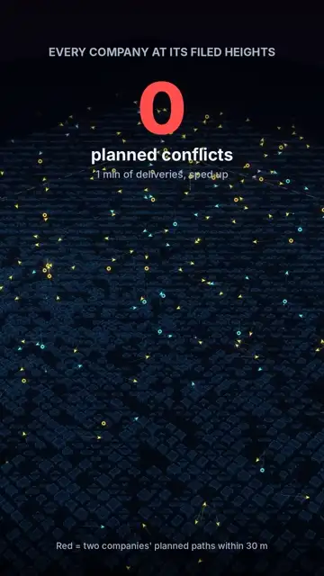

# Shared Sky

*Formerly Sky-Grid (renamed 5 Nov 2026: "SkyGrid" is the name of an unrelated airspace-management company). Dated records written before the rename, including the fingerprinted registrations, keep the old name, because editing them would break their fingerprints.*

   
  Same Houston flights, two height rules (the site's demo patch: 92 → 33 planned conflicts). <a href="https://forgottenl5.github.io/shared-sky/houston.html">Fly it in 3D</a>

A simulation of Wing, Zipline and Amazon delivery drones sharing the sky over Houston and Dallas–Fort Worth, built from the companies' FAA environmental filings. It flies their planned operations together and tests one simple rule: **each company keeps to its own height inside the band it already filed**.

**With plan sharing** (as operators already do: ASTM F3548; in DFW, Wing and Flytrex report thousands of coordinated flights with no plan conflicts), the rule **halves how many flights have to wait** for another company's plan: 19 % instead of 39 % in Houston, 17.5 % instead of 36.5 % in DFW, about 6 minutes each, in a modelled pre-flight check flown in real 2025 wind over 10 windy hours (`planned/SEEDS2_RESULTS_2026-10-28.md`). The check removes 99–99.6 % of planned conflicts with or without the rule. The halving depends on how big each flight's shared plan is: it holds with plans of ±75 m / ±15 m (20–21 % vs 52–54 % held), but with ±150 m / ±25 m the shared-out heights barely help (64–69 % vs 67–73 %) and only flexible heights stay low (25–28 %; `planned/INTENT1_RESULTS_2026-11-24.md`).

**Without plan sharing**, as a reference point for how far plans overlap on their own, the model counts **planned conflicts** (two companies' planned paths within 30 m sideways and less than 10 m in height at the same moment): the rule cuts them by about 72 % (Houston) and 73 % (DFW).

**Live pages:** `docs/` (GitHub Pages): `index.html`, `houston.html`, `dfw.html`, `lab.html` (run your own scenario in the browser).

## Main results
- **With plans shared before take-off, own heights halve how many flights wait:** 18.9 % vs 38.8 % (Houston) and 17.5 % vs 36.5 % (DFW) of flights held, mean 6.2–6.6 minutes, against today's filed heights with Amazon at its Omaha noise profile (10 windy hours per metro, daytime hours between the 85th and 95th percentile of wind; calm hours would hold fewer). On real Walmart site layouts the halving holds: 34 % → 16 % (Houston), 28 % → 15 % (DFW) (`planned/REALCOORD_RESULTS_2026-11-23.md`). The modelled check is not any operator's real system. Amazon bears most of the waiting either way (about 71–84 % of its flights held): its depot climbs and descents cross every other layer, so height sharing halves the total by cutting Wing's and Zipline's waits, not Amazon's. Catch: Amazon's outbound and Zipline's shared-out heights sit exactly 20 m apart, the edge of what the modelled check sees, so with average GPS error the shared-out heights keep slightly more residual collision risk than the best-sourced ones (`planned/RISK2_*`); layer gaps need a margin.
- **A better set of heights inside the filed bands** (`planned/LAYOUT1_RESULTS_2026-11-24.md`): Wing 46–52 m, Amazon 76 m both ways, Zipline 101 m (gaps 24 and 25 m) cuts held flights to about 4 % (Amazon 18–26 %), keeps the uncoordinated cut at 75–92 % under every separation rule, and leaves less residual collision risk than the shared-out heights. Not measured: the cost to each company of keeping its own fleet apart in a narrower band. Putting Amazon lowest instead looks better on waiting but leaves Wing and Zipline 21 m apart, just outside the check, with 3–8 times the risk. 3 of 7 predictions held.
- **But it depends on the size of the shared flight plans** (`planned/INTENT1_RESULTS_2026-11-24.md`): the 4 % assumes each flight reserves about ±10 m in height. With ±15 m the wider-gap layout is no better than the shared-out heights (21–22 % held); with ±25 m flexible heights (the coordination service moves a flight inside its company's band before holding it) do best (25–28 %, against 38–39 % and 64–73 %). Flexible heights are the only plan that stays at 18–28 % at every size tested. At today's Houston volume about 1 % of flights are held and there are no conflicts, as in real operations.
- **With plans sized by the standard's own 95 % rule** (`planned/INTENT2_RESULTS_2026-11-24.md`; each plan covers the aircraft's 95 % position error: ±10 m sideways, ±14 m in height at average GPS): today's heights hold 47–51 % of flights and every height-sharing plan 17–22 %, so the headline gets stronger. The plans differ in leftover collision risk: the wider-gap layout 0.005–0.006 per 100,000 flight hours, the shared-out heights 0.04–0.06, flexible heights 0.18–0.41. INTENT1's suggestion that flexible heights are the safer bet is withdrawn. Best-site GPS cuts holds 3–12 times and risk by orders of magnitude.
- **Without coordination, sharing out heights cuts planned conflicts by 72 % in Houston (95 % interval 67–76 %) and 73 % in DFW (66–80 %)**, with Amazon at its best-sourced heights, on the real filed layouts (Amazon's geocoded sites; Wing and Zipline placed at random), 10 runs each (`planned/HEADLINE2_RESULTS_2026-10-25.md`).
- **Two things decide that number.**
  - *Amazon's return height* is not public. FAA filings give a typical return of 345 ft. One secondhand homeowners' association summary quotes Amazon staff saying "400 ft". If 400 ft is true, the cut is 29 % (Houston) or 35 % (DFW).
  - *How much room companies need.* The shared-out layers are 10–20 m apart. Across vertical rules of 5–20 m and horizontal rules of 20–50 m the cut stays between 45 % and 84 % (`planned/CURVE1_RESULTS_2026-11-23.md`): 66–70 % at 5 m, 72–73 % at 10 m, 80–83 % at 12.5 m, but 55 % (Houston) / 45 % (DFW) at 15 m, where Amazon's return (115 m) and Zipline (101 m), 14 m apart, start to count against each other; 67 % / 60 % at 20 m. The horizontal rule matters little.
- **Today versus build-out.** With only the sites flying in Houston today, the plans almost never meet. Planned conflicts grow roughly with the square of traffic (a property of any model without avoidance): about 0.5 an hour early in the build-out, 6 mid, 36 at the full filed build-out (DFW: 0.5 / 3 / 25). Most involve Amazon and Zipline.
- **Amazon at its reported volume** (about 200 flights a day in Richardson, 20 % of its filed cap): full build-out conflicts fall about two thirds; Amazon is still about 80 % of what remains.
- **Plan check.** A deliberately minimal check (±5 s, no wind allowance) removes planned conflicts in still air but not in wind; booking ±30 s fixes most of it. Real coordination systems size their reservations to timing uncertainty, so this is a statement about the minimal check, not about real systems.
- **Stress tests** (far above any real failure rate): sending every drone home at its own company's height beats one common height by 6–11×; note that the common height tested (120 m) sits 5 m from Amazon's allocated return, and no operator proposes a common height.
- **Air taxis near drone routes:** no public routes. A narrow check puts about 19 drones an hour (7–51 over layouts) within 1 km of Toyota's Plano HQ at full DFW build-out.
- **Air-taxi networks (separate model, `taxi/`):** small networks on the DFW and Houston sites Joby, Archer and Wisk have flown or named. Flying beats Google's typical peak-hour drive if getting to and from the pads takes less than 20 min (DFW Airport–Toyota) to 44 min (Alliance–Toyota) in total. About 8 aircraft serve 12 trips an hour in DFW and 5 serve 6 an hour in Houston. Two pads per site cope up to about 30 take-offs and landings an hour. Demand, pads and range are assumptions (`planned/AIRTAXI_NET1_*`, `planned/AIRTAXI_NET2_*`). Noise (`planned/AIRTAXI_NOISE1_*`, from Joby's reported levels): heard at 55 dBA or more only within about 2.4 km of a site; no point more than 300 m from a site comes near FAA DNL 65 (highest 54 dB); about 15 loud flights an hour 1 km out from DFW Airport at 48 trips an hour. 3D page with a noise layer: `docs/airtaxi.html`.

## Glossary
- **Planned conflict:** planned paths of two different companies within 30 m horizontally and less than 10 m vertically at the same moment (checked 4 times a second). **Tight conflict:** within 15 m and 5 m. Not a collision or a near-miss: the model has no avoidance and no coordination.
- **Omaha profile:** Amazon at 61 m out and 105 m back, the profile in the FAA's Omaha noise analysis (typical 200 ft out / 345 ft back).
- **Best-sourced heights:** Amazon at 69 m out (225 ft, its stated Richardson average) and back anywhere in 85–115 m (the return band in its Florida, Detroit and Kansas City filings; its Texas filing gives one 55–115 m band for both legs).
- **High-return case:** Amazon at 69 m out and 122 m (400 ft) back; source is a secondhand staff remark only.
- **Shared out:** Wing 46–71 m, Amazon 81 m out and 115 m back, Zipline 101 m, all inside each company's filed band.
- **Build-out:** sites opening from today's few to the full counts in the FAA filings (Houston: 75 Wing, 65 Zipline, 6 Amazon, of which 5 could be geocoded and are used; Zipline's Houston filing is a draft EA, Sep 2026).
- **Cap:** the filed maximum flights per site per day. Filed caps on overlapping service areas are **not** applied, so busy overlap areas fly above them.

## How results are kept honest
Every study is written down and fingerprinted (sha256) **before** its code or runs (`planned/*_PREREG.md`), the runner and analysis are committed before the runs, failed predictions are reported as failures, and corrections are appended to each registration's deviation log. Check the fingerprints with `python3 planned/verify_prereg.py` (see `VERIFY.md` for the convention and its limits). `planned/SKYGRID_MASTER_PLAN.md` lists every study; `planned/REVIEW_*` and `planned/PAGEAUDIT_*` record outside and internal reviews.

## Reproducing
- Node.js 22 for the engine and runners (no npm packages); Python 3 with `requirements.txt` for analyses.
- Each runner has a fast check: `node planned/<study>_run.js checks`. Runs: `node planned/<study>_run.js <shard> <n>`; outputs go to `out/` (not committed); then `python3 planned/<study>_analyze.py`.
- Build the site (since 23 Nov 2026 the bad-day scenarios use exact hovering): `node planned/export_city.js out/hou.json` and `METRO=dfw node planned/export_city.js out/dfw.json` (about 4 minutes each), then `city/build_site.sh out/hou.json out/dfw.json`. This reproduces `docs/` byte for byte.

## Data tables
The headline study's 80 run records and the website's demo patch as Parquet/CSV tables, with a data dictionary and a notebook that recomputes the headline (CC BY 4.0): [huggingface.co/datasets/forgottenl5/shared-sky](https://huggingface.co/datasets/forgottenl5/shared-sky) and [kaggle.com/datasets/forgottenl5/shared-sky](https://www.kaggle.com/datasets/forgottenl5/shared-sky). Rebuild them with `python3 tools/export_dataset.py OUTDIR`.

## Layout
- `lab/lab_engine.js`: the planned-operations engine (flights, plan check, planned-conflict counter).
- `planned/`: study registrations, runners, analyses and results (from 22 Oct 2026).
- `taxi/`: the air-taxi network engine (`net2.js`; `net.js` is the frozen v1 used by AIRTAXI_NET1), its checks, drive-time data and the 3D network page (`airtaxi.template.html`, `export_airtaxi.js`, `build_airtaxi.js`).
- `city/`: the 3D city pages (`city.template.html`, `build_city.js`, `build_site.sh`).
- `data/`: public input data (see `data/LICENSE.md`).
- `tests/test_cities.js`: per-city regression test. This public copy leaves out an earlier engine and its studies (20–22 Oct 2026, not on the scorecard), working notes (plans, reviews, audits) and hand-read Google Maps drive times (see `taxi/data/DRIVE_TIMES_WITHHELD.md`). Three registrations have a private resident's street redacted (`planned/REDACTED.txt`).

## Known limits
Straight-line routes; customers uniform within service areas (Census weighting tested); demand spread evenly over the day (no peaks); no navigation error (height error of 3 m / 5 m tested); Wing autoloaders not modelled; Amazon's day is 16.5 h rather than the Texas EA's 15 h; Wing and Zipline site positions random; overlap caps not applied; Flytrex and other DFW operators not modelled.

## Data and credits
FAA environmental assessments (Wing, Zipline, Amazon); FAA UAS facility maps; US Census Bureau 2020 centres of population; [Open-Meteo](https://open-meteo.com/) historical weather (CC BY 4.0); © OpenStreetMap contributors (ODbL) for buildings and store locations; TU Delft BlueSky (cross-check).

## Not
Not affiliated with, endorsed by or reviewed by Wing, Zipline, Amazon or the FAA. Not flight data, a forecast or safety advice.

## Licence
Code: AGPL-3.0-or-later. Text and results: CC BY 4.0. Details in [LICENSING.md](LICENSING.md). Data in `data/` keeps its own licences.

## Cite

Archived on Zenodo: [doi:10.5281/zenodo.24482589](https://doi.org/10.5281/zenodo.24482589) (all versions; v1.0.0 is [10.5281/zenodo.24482590](https://doi.org/10.5281/zenodo.24482590)). GitHub's "Cite this repository" button uses `CITATION.cff`.
